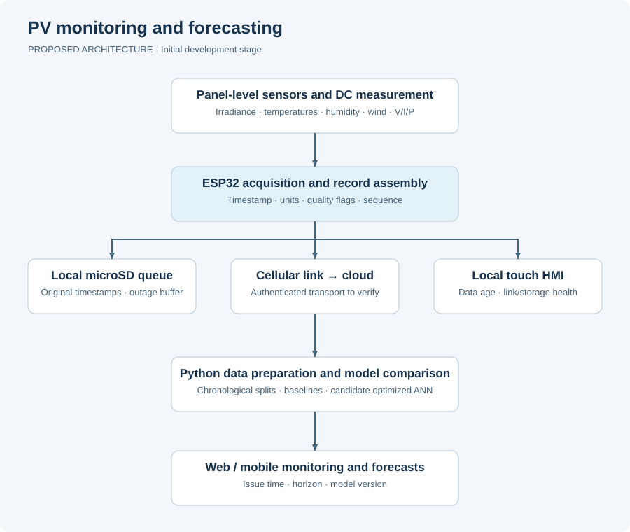

# PV Power Forecasting with Microclimate Sensing and IoT

[Türkçe açıklama](README.tr.md) · [Current status](STATUS.md) · [Roadmap](ROADMAP.md) · [Validation plan](docs/validation-plan.md)

An early-stage research project at Ege University to develop an autonomous, panel-level monitoring station and evaluate how local microclimate measurements affect photovoltaic power forecasts.

**Project status:** TÜBİTAK 1002-A support approved; development is beginning. This repository currently contains the public technical overview, proposed architecture, requirements, validation plan, and a small telemetry validation utility. Hardware operation and forecasting performance have not yet been demonstrated here.

## Engineering problem

Regional weather data may not represent the conditions experienced by a particular PV panel. This project will collect synchronized local environmental and electrical measurements and compare forecasting models built with local measurements against models using regional weather inputs.

The intended outcome is a traceable path from physical measurements to a quality-controlled time series, reproducible forecasting experiments, and local/remote monitoring.

## Planned system architecture



The proposed station combines an ESP32 TTGO T-Call, a sensor acquisition layer, RTC timestamps, local microSD storage, cellular communication, and a local touch display. A cloud service will support web/mobile monitoring and Python-based model development. Components and interfaces remain subject to engineering review.

## Scope and design targets

All numbers below are **proposal targets**, not measured results.

| Item | Planned value or method |
| --- | --- |
| Pilot site | Ege University, Aliağa, İzmir |
| PV panel | 550 W nominal rating in the proposal |
| Primary environmental channels | Irradiance, ambient temperature, panel temperature, relative humidity, wind speed |
| Auxiliary channels | Wind direction and derived sunshine indicator |
| Electrical measurements | DC voltage, current, and power |
| Raw logging interval | 60 s |
| Aggregation windows | 10 min, 30 min, and 1 h |
| Acquisition period | At least 4 months; 6 months desired |
| Data completeness | ≥98% of expected valid records |
| Modbus test | ≥99% valid transactions; CRC error ratio ≤1% in a 72 h test |
| Offline operation | Local logging during cloud outages; replay after reconnection |
| Energy autonomy | 5 days under the design no-sun scenario |
| Forecast horizons | 1 h, 6 h, 12 h, and 24 h |
| Short-horizon model targets | nRMSE ≤10%, R² ≥0.95; MAPE ≤8% under a predefined low-power rule |
| Long-horizon model targets | nRMSE ≤15%, R² ≥0.90 |
| Comparison target | ≥15% relative RMSE improvement over the defined macro-weather reference |

The panel-temperature channel is intended as a proxy for cell temperature; sensor placement and calibration must be documented. Actual available PV power versus power limited by the station load/charge controller is an open measurement-design decision.

## Planned hardware and software

| Layer | Candidates from the proposal | Current state |
| --- | --- | --- |
| Embedded acquisition | ESP32 TTGO T-Call, FreeRTOS task structure | Planned |
| Sensor interfaces | RS485/Modbus RTU where supported by the purchased sensor variants | Datasheets and register maps to confirm |
| Power measurement | PZEM-017 with an appropriately rated shunt | Planned |
| Time and storage | DS1302 RTC and microSD | Planned |
| Connectivity | SIM800L cellular link and M2M SIM | Network/protocol compatibility to verify |
| Local interface | ILI9341-based touch TFT | Planned |
| Cloud and clients | Firebase candidate, web/mobile views | Planned |
| Analysis | Python; pandas/NumPy and visualization tools | Planned research pipeline |
| Forecast models | Linear regression, SVR, standard ANN, optimized ANN | Planned comparison |
| Optimization candidates | PSO, GWO, WOA, GA | No winning algorithm selected |

## Research and validation approach

1. Define the electrical measurement point, units, timestamp rules, and sensor calibration records.
2. Validate acquisition, local storage, and outage recovery before collecting a long dataset.
3. Build leakage-aware time-series datasets for each forecast horizon.
4. Use the first 80% of the chronological period for training/development and the final 20% as a held-out test period, with a gap sufficient to prevent target-window overlap.
5. Select models and hyperparameters using walk-forward validation inside the training period.
6. Compare persistence, regression, SVR, standard ANN, and candidate optimized ANN models under a common evaluation protocol.
7. Report measured metrics, uncertainty, failure cases, and differences from proposal targets.

Future measured weather must not be used as an input to a forecast that is supposed to be issued earlier. See [the validation plan](docs/validation-plan.md) for feature availability and nighttime metric rules.

## Try the included starter utility

The telemetry checker uses only the Python standard library. It checks a **synthetic example**, not station data. It does not read physical sensors, contact a cloud service, or train an ANN.

```bash
python tools/validate_telemetry.py examples/telemetry_synthetic.csv
python -m unittest discover -s tests -v
```

On Windows, `py` can replace `python` when the Python launcher is installed. Python 3.10 or newer is sufficient for this utility; Python is optional if you only want to read the documentation.

## Documentation

| Document | Purpose |
| --- | --- |
| [Requirements](docs/requirements.md) | Traceable targets and acceptance evidence |
| [Architecture](docs/architecture.md) | Acquisition, storage, communication, HMI, and analysis boundaries |
| [Hardware plan](docs/hardware-plan.md) | Component candidates and integration checks |
| [Data dictionary](docs/data-dictionary.md) | Proposed telemetry fields, units, and provenance |
| [Validation plan](docs/validation-plan.md) | Acquisition tests and reproducible forecasting evaluation |
| [Open decisions](docs/open-decisions.md) | Unresolved measurement and implementation choices |
| [Backlog](docs/backlog.md) | Tasks ready to turn into GitHub Issues |
| [Contributors](CONTRIBUTORS.md) | Team context and Emre's planned responsibilities |

## Team and my planned contribution

This is a team research project led by **Dr. Günnur Şen**, with **Abdullah Elen** included in the academic team. Based on the proposal's work-package allocation, **Emre Teltik** is assigned to hardware/sensor integration, embedded acquisition and local HMI development, and system-level performance testing. Cloud, data preparation, and model-development tasks are shared across other assigned team members; this repository does not attribute the complete system to one person.

## Results and reuse

No field dataset, trained model, or verified forecast score is published in this initial version. Results will be added with their data version, code version, test protocol, and measurement conditions. The complete application form, personal details, access credentials, and internal budget are excluded from this public-facing package. Licensing and the release of research data/code will be coordinated with the project team.
